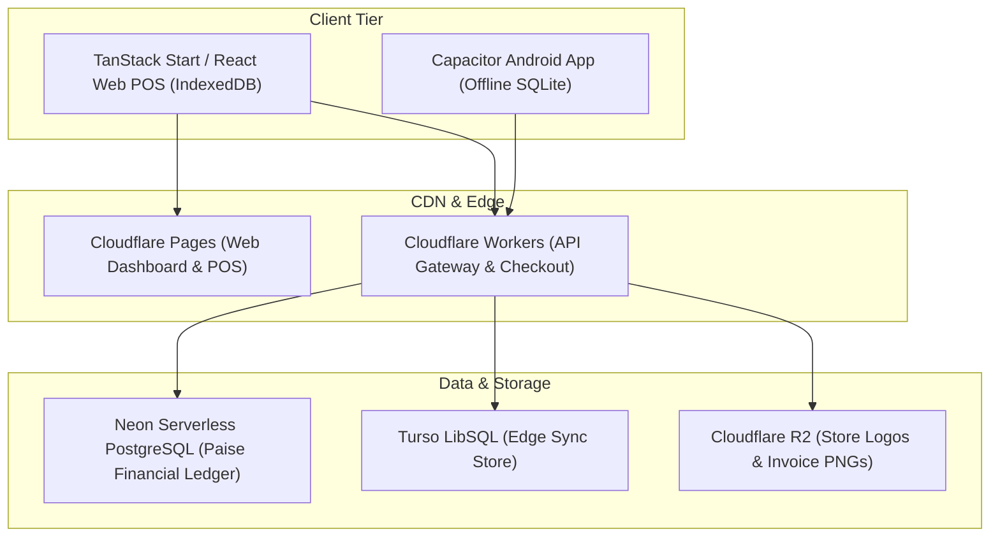

# Apka Bill / Orion POS — Free-Tier Infrastructure Architecture Guide
> Curated from https://free-for.dev/#/?id=web-hosting & Developer Cloud Ecosystem

This document serves as the persistent architectural reference for deploying and running Apka Bill with **zero or near-zero operational costs** across Frontend, Backend, Database, Media Storage, and Offline-First Sync.

---

## 1. Stack Requirements & Free-Tier Mapping

| Component | Apka Bill Requirement | Primary Free Tier Recommendation | Backup / Alternative |
| :--- | :--- | :--- | :--- |
| **Web Frontend & PWA** | TanStack Start / Vite / React SPA + SSR | **Cloudflare Pages** (Unlimited bandwidth, 500 builds/mo) | **Vercel** (100 GB bandwidth, preview URLs) |
| **Backend API** | Express 5 / Node.js or Cloudflare Worker | **Cloudflare Workers** (100k req/day, 0ms cold start) | **Render** (Free Docker/Node web service, sleeps after 15m) |
| **Relational Database** | PostgreSQL 16+ (Integer Paise, Multi-tenant) | **Neon Postgres** (0.5 GB, 100 CU-hrs, autoscaling) | **Prisma Postgres** / **Aiven** (1 GB free Postgres) |
| **Edge / Sync Database** | SQLite sync hub for offline-first stores | **Turso** (9 GB storage, 500 SQLite DBs, 1B reads/mo) | **Cloudflare D1** (5 GB, 5M reads/day) |
| **Media & Assets** | Store Logos, Branded Invoice PNGs, PDFs | **Cloudflare R2** (10 GB free, \$0 egress fees) | **ImageKit** (20 GB bandwidth + auto-resizing) |
| **Image Optimization** | Monochromatic thermal logo bitmaps (58/80mm) | **weserv.nl** (Free on-the-fly image cache & resize) | **Cloudinary** (25 credits/mo) |
| **DNS, SSL & WAF** | Custom domain routing, DDoS protection | **Cloudflare Free Zone** (Universal SSL, DDoS, WAF) | **Namecheap Supersonic** |

---

## 2. In-Depth Evaluation of `free-for.dev/#/?id=web-hosting`

### A. Frontend Web Hosting (Web POS & Merchant Portal)
1. **Vercel (`vercel.com`)**
   - **Free Plan**: 100 GB bandwidth, unlimited serverless function invocations within hobby limits, Git preview URLs for every commit.
   - **Apka Bill Fit**: **Best for rapid frontend deployment**. Vite and TanStack Start run natively with zero configuration.
2. **Netlify (`netlify.com`)**
   - **Free Plan**: 300 build minutes/month, 100 GB bandwidth, custom headers and redirect rules.
   - **Apka Bill Fit**: **Excellent fallback**. Easy drag-and-drop or Git CI/CD.
3. **DigitalOcean App Platform (`digitalocean.com/pricing`)**
   - **Free Plan**: Up to 3 static sites free on Starter tier.
   - **Apka Bill Fit**: Great for hosting public landing pages, user manuals, and privacy policies for Google Play Store compliance.

### B. Backend API & Compute Hosting
1. **Cloudflare Workers (`workers.cloudflare.com`)** *(Already integrated in `backend/src/worker.ts`)*
   - **Free Plan**: 100,000 requests/day, 10ms CPU time per request, 0ms cold starts globally across 300+ edge locations.
   - **Apka Bill Fit**: **Highest efficiency for POS**. India-local edge points (Mumbai, Delhi, Chennai, Bangalore) deliver sub-20ms checkout response times.
2. **Render (`render.com`)**
   - **Free Plan**: 512 MB RAM web service, free SSL, Git auto-deploys, custom domains.
   - **Apka Bill Fit**: **Best for running full Node.js/Express without Worker limitations** (e.g. background job processing, PDF generation via Puppeteer/native canvas). Note: Spun down after 15 mins of inactivity; warm-up takes ~30-45s.
3. **Koyeb (`koyeb.com`)**
   - **Free Plan**: 550 free compute hours/month (512 MB RAM), free Postgres DB, custom domain SSL.
   - **Apka Bill Fit**: Can host a containerized Docker backend service.

---

## 3. High-Leverage Adjacent Services (Databases, Sync & Media)

### A. Database Layer
- **Neon (`neon.com`)**:
  - *Current Status*: Active in Apka Bill.
  - *Free Tier*: 0.5 GB storage, 100 CU-hours compute/month, 10 project branches (perfect for staging vs prod schema testing).
- **Turso (`turso.tech`)**:
  - *Free Tier*: 9 GB storage, up to 500 databases, 1 billion row reads/month.
  - *High Value Use Case*: Can provide a dedicated SQLite database in the cloud for every retail organization that mirrors the mobile client's SQLite store, enabling effortless bidirectional offline-first sync.

### B. Media & Receipt Image Assets
- **Cloudflare R2**:
  - 10 GB free object storage forever, with **zero egress bandwidth fees**. Ideal for storing customer invoice PDF backups, receipt images, and uploaded store logos.
- **ImageKit (`imagekit.io`)**:
  - 20 GB/month free bandwidth, automatic format conversion (WebP/AVIF), and URL-based image resizing. Ideal for generating pre-scaled 384-pixel monochrome images for 58mm thermal printers directly via URL.

---

## 4. Zero-Cost Recommended Production Topology

---

## 5. Implementation Action Plan

1. **Staging / Testing API**:
   - Host `backend` on **Cloudflare Workers** (via existing `npm run deploy` / `backend/src/worker.ts`) or **Render** for Express compatibility.
2. **Web POS App**:
   - Deploy `dist-capacitor/` or Vite client output to **Cloudflare Pages** or **Vercel** with custom domain `pos.apkabill.in`.
3. **Receipt & Logo Media Storage**:
   - Replace base64 logo localStorage storage with **Cloudflare R2** public URLs or **ImageKit** CDN transforms for extreme thermal printing speed.

